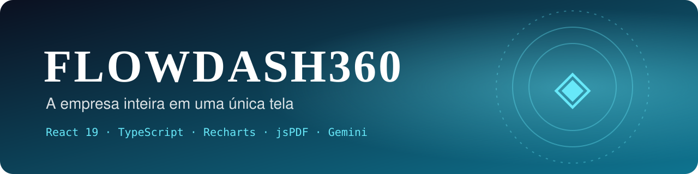
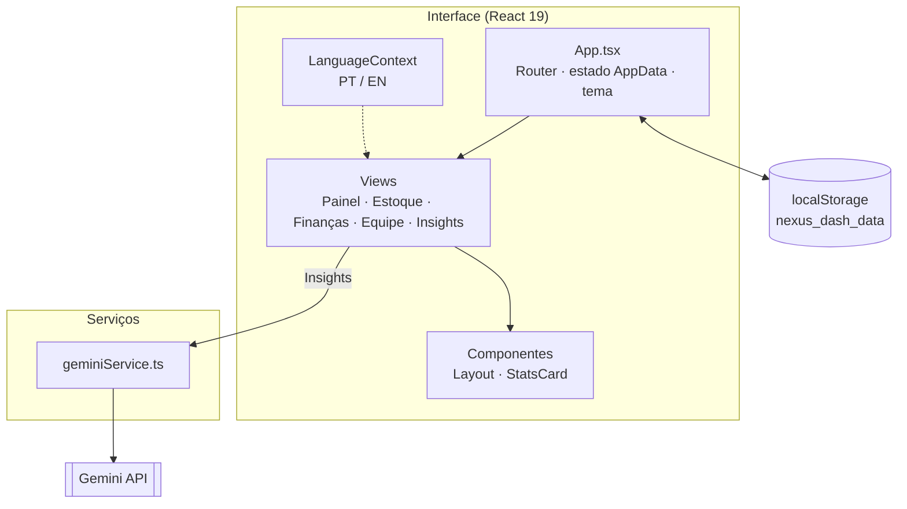
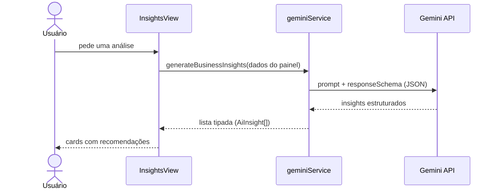

<div align="center">



# ◈ FlowDash360
### A empresa inteira em uma única tela

**Painel de gestão empresarial (ERP leve) para pequenos negócios, com React 19 e TypeScript.**
Estoque, finanças e equipe em um só lugar, gráficos com Recharts, relatórios em PDF<br/>
e insights estratégicos gerados por IA (Gemini), tudo rodando no navegador, sem backend.


</div>

---

## 👨‍💻 Autor

<table>
  <tr>
    <td width="62%">

Eu sou o **Gustavo Osterno Thé**, e o **FlowDash360** é um dos projetos do meu portfólio público. Idealizei, desenvolvi e mantenho este repositório.

Escolhi construí-lo porque é a ferramenta que pequenas empresas mais pedem: enxergar **estoque, caixa e equipe** sem planilhas espalhadas. Fiz tudo no front-end, com persistência local, para validar a experiência antes de investir em servidor. O passo natural seguinte é levar esses mesmos dados para uma API, como faço na [Bifrost](https://github.com/GustavoThe01/bifrost-orders).

    </td>
    <td width="38%">

| | |
|---|---|
| 🌐 Site | [site-gustavothe-dev.web.app](https://site-gustavothe-dev.web.app/) |
| 💼 LinkedIn | [gustavoosterno](https://www.linkedin.com/in/gustavoosterno/) |
| 🐙 GitHub | [@GustavoThe01](https://github.com/GustavoThe01) |
| 📸 Instagram | [@gustavo.osterno](https://www.instagram.com/gustavo.osterno) |

    </td>
  </tr>
</table>

---

## 📑 Sumário

- [Em números](#-em-números)
- [A origem do nome](#-a-origem-do-nome)
- [O que o sistema faz](#-o-que-o-sistema-faz)
- [Rotas e telas](#-rotas-e-telas)
- [Arquitetura](#️-arquitetura)
- [Como um insight é gerado](#-como-um-insight-é-gerado)
- [Competências demonstradas](#-competências-demonstradas)
- [Metodologias e decisões](#-metodologias-e-decisões)
- [Roadmap](#️-roadmap)
- [Como rodar](#-como-rodar)
- [Testes](#-testes)
- [Estrutura do projeto](#-estrutura-do-projeto)
- [O que ainda falta](#-o-que-ainda-falta)
- [Projetos relacionados](#-projetos-relacionados)

---

## 📊 Em números

<div align="center">

| 🧩 Produto | 🛠️ Stack | 💾 Dados | 🗓️ Processo |
|:---:|:---:|:---:|:---:|
| **5** módulos (painel, estoque, finanças, equipe, IA) | React **19** + TypeScript | **local-first** (`localStorage`) | **4** commits · fev/2026 |
| **2** idiomas (PT / EN) | Recharts (área e pizza) | dados de exemplo no 1º acesso | protótipo no Google AI Studio |
| tema claro / escuro | jsPDF + AutoTable | IA com **JSON estruturado** | versão **beta** concluída |

<sub>Números do estado atual do repositório. O que vem a seguir está em <a href="#-o-que-ainda-falta">O que ainda falta</a>.</sub>

</div>

---

## ◈ A origem do nome

> *"Visão 360°" é como a gestão chama enxergar um negócio por todos os ângulos ao mesmo tempo.*

**Flow** vem do fluxo (de caixa, de mercadorias, de trabalho), **Dash** vem de dashboard e **360** é a promessa: abrir uma única tela e ver a empresa inteira, do produto parado na prateleira ao dinheiro que entrou hoje.

---

## ✨ O que o sistema faz

| Módulo | O que resolve |
|---|---|
| 📊 **Painel** | KPIs do negócio e gráficos de área e pizza em uma visão só |
| 📦 **Estoque** | Cadastro de produtos, quantidades e valor parado em estoque |
| 💰 **Finanças** | Entradas e saídas, saldo e **relatório em PDF** (jsPDF + AutoTable) |
| 👥 **Equipe** | Colaboradores, cargos e informações do time |
| 🧠 **Insights** | Análise do negócio gerada pelo **Gemini** a partir dos dados do painel |
| 🌗 **Experiência** | Tema claro/escuro e interface em **português ou inglês** |

---

## 🌐 Rotas e telas

| Rota | Tela | O que mostra |
|---|---|---|
| `/` | Painel | Indicadores e gráficos gerais |
| `/inventory` | Estoque | Produtos e níveis de estoque |
| `/finance` | Finanças | Transações, saldo e exportação em PDF |
| `/collaborators` | Equipe | Colaboradores |
| `/insights` | Insights | Recomendações geradas por IA |
| `*` | — | Redireciona para o painel |

---

## 🏛️ Arquitetura

Uma SPA sem backend: o estado da aplicação vive no `App`, é salvo no `localStorage` a cada mudança e é distribuído para as telas. A única chamada externa é a do Gemini, isolada em um serviço.



---

## 🔄 Como um insight é gerado



> 💡 Peço a resposta em **JSON com schema** em vez de texto livre: assim a interface sempre recebe um formato previsível e tipado.

---

## 🧠 Competências demonstradas

| Área | Conceitos |
|---|---|
| **React** | Componentização, React Router 7, Context API (idioma), estado derivado |
| **TypeScript** | Modelagem de domínio com interfaces (`Product`, `Transaction`, `Collaborator`, `AppData`) |
| **Dados** | Persistência local-first, dados iniciais, sincronização automática com `localStorage` |
| **Visualização** | Gráficos com Recharts, relatórios PDF com jsPDF + AutoTable |
| **IA** | Gemini com saída estruturada (`responseSchema`) |
| **UX** | Tema claro/escuro, internacionalização PT/EN, layout responsivo |

---

## 🧭 Metodologias e decisões

- **Local-first**: validei o produto inteiro sem servidor; os dados ficam no navegador do usuário.
- **IA com contrato**: a resposta do modelo é um JSON com schema, não texto solto.
- **Protótipo no Google AI Studio**: por isso o `metadata.json` e as dependências carregadas via *import map*.
- **Serviço isolado** para a IA, pronto para ser trocado por uma chamada a um backend.

---

## 🗺️ Roadmap

| Fase | Tema | Versão | Progresso |
|---|---|:---:|---|
| 1 | Módulos, gráficos, PDF, IA e i18n | `beta` | 🟩🟩🟩🟩🟩 |
| 2 | Testes, lint e CI | `v1.0.0` | ⬜⬜⬜⬜⬜ |
| 3 | Backend com autenticação e chave da IA no servidor | `v2.0.0` | ⬜⬜⬜⬜⬜ |

---

## 🚀 Como rodar

**Pré-requisito:** [Node.js 20+](https://nodejs.org/).

```bash
git clone https://github.com/GustavoThe01/flowdash360-beta.git
```

```bash
cd flowdash360-beta
```

```bash
npm install
```

Crie um arquivo `.env.local` na raiz com a sua chave do [Google AI Studio](https://aistudio.google.com/apikey) (só é necessária para a tela de Insights):

```bash
GEMINI_API_KEY=sua_chave_aqui
```

```bash
npm run dev
```

Acesse `http://localhost:3000`.

> ⚠️ O Vite injeta a `GEMINI_API_KEY` no código do navegador. Use este projeto **apenas localmente**; para publicar, as chamadas à IA precisam passar por um backend.

---

## 🧪 Testes

Ainda não há testes automatizados neste repositório. O plano:

| Tipo | Ferramenta | Situação |
|---|---|---|
| Unitários (cálculos de finanças e estoque) | Vitest | ⏳ Planejado |
| Componentes | Testing Library | ⏳ Planejado |
| Fluxos principais | Playwright | ⏳ Planejado |

---

## 📁 Estrutura do projeto

```
flowdash360-beta/
├── components/
│   ├── DashboardView.tsx     # ✅ KPIs e gráficos
│   ├── InventoryView.tsx     # ✅ estoque
│   ├── FinanceView.tsx       # ✅ finanças + exportação PDF
│   ├── CollaboratorsView.tsx # ✅ equipe
│   ├── InsightsView.tsx      # ✅ insights com IA
│   ├── Layout.tsx            # ✅ menu, tema e idioma
│   └── StatsCard.tsx
├── contexts/
│   └── LanguageContext.tsx   # ✅ PT / EN
├── services/
│   └── geminiService.ts      # ✅ chamada ao Gemini com responseSchema
├── docs/assets/              # ✅ banner
├── App.tsx                   # ✅ rotas, estado e persistência
├── constants.ts              # ✅ dados de exemplo
├── types.ts                  # ✅ modelos do domínio
├── index.html
└── vite.config.ts
```

---

## 🧩 O que ainda falta

Mantenho aqui um checklist vivo do que ainda vou incrementar neste repositório.

**Projeto**
- [x] Painel, estoque, finanças, equipe e insights com IA
- [x] Relatório financeiro em PDF
- [x] Tema claro/escuro e interface PT/EN
- [ ] Testes com Vitest e Testing Library
- [ ] Lint e GitHub Actions
- [ ] Mover a chamada ao Gemini para um backend (sem chave no navegador)
- [ ] Importar e exportar dados (CSV / JSON)

**README**
- [ ] Prints das telas e GIF do fluxo de insights
- [ ] Link de uma demonstração publicada
- [ ] Definir e adicionar uma licença (`LICENSE`)

---

## 🔗 Projetos relacionados

| Projeto | Stack | Relação |
|---|---|---|
| ◭ [MarketDash](https://github.com/GustavoThe01/invest-dashboard-react) | React + Gemini | O mesmo formato de dashboard, aplicado ao mercado financeiro |
| ☑ [ThéTask](https://github.com/GustavoThe01/taskboard-react-ts) | React + Gemini | Produtividade da equipe, com planejamento por IA |
| ⚿ [GateKeeper](https://github.com/GustavoThe01/gatekeeper-rbac) | React | Login e permissões que este painel ainda não tem |
| ✦ [Bifrost](https://github.com/GustavoThe01/bifrost-orders) | ASP.NET Core | O tipo de API que daria um backend a este painel |
| ◈ **FlowDash360** | React 19 | *você está aqui* |

<div align="center">

<sub>Painel montado por mim, de ponta a ponta · <a href="https://github.com/GustavoThe01">Gustavo Osterno Thé</a></sub>

</div>
